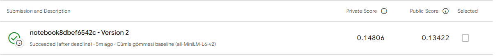

# GROUP23_CENG313: Mining Misconceptions in Mathematics

CENG313 Veri Bilimine Giriş dersi projesi. Proje, Kaggle yarışması
[Eedi - Mining Misconceptions in Mathematics](https://www.kaggle.com/competitions/eedi-mining-misconceptions-in-mathematics)
üzerine kuruludur.

## Grup 23

| Ad Soyad | Öğrenci No | GitHub | Ödev 1'deki sorumluluk |
|---|---|---|---|
| İbrahim BETBAŞI | 23118080058 | [ibiqss](https://github.com/ibiqss) | Veri yükleme, ön işleme, keşifsel veri analizi, popülerlik baseline'ı |
| Koray CİHAN | 23118080043 | [KorayCihan](https://github.com/KorayCihan) | Doğrulama ve metrik, metin tabanlı baseline'lar, Kaggle gönderimi |

## Yarışma

Her çoktan seçmeli matematik sorusunun bir doğru ve üç yanlış şıkkı vardır. Amaç, her
yanlış şık için öğrencinin bu şıkkı seçmesine yol açmış olabilecek kavram yanılgısını
(misconception) tahmin etmektir. Her yanlış şık için 2.587 aday arasından en olası 25
tanesi sıralanır ve sonuç MAP@25 ile değerlendirilir.

## Veri seti

Veri yarışma tarafından sağlanır ve Kaggle kuralları gereği bu repoya eklenmez
(`data/` klasörü `.gitignore` içindedir).

| Dosya | İçerik |
|---|---|
| `train.csv` | Soru başına bir satır: soru metni, konu, construct, dört şık metni, doğru şık ve her yanlış şık için bir kavram yanılgısı kimliği |
| `test.csv` | Etiketsiz aynı sütunlar (açık dosyada yalnızca 3 soru) |
| `misconception_mapping.csv` | Aday listesi: `MisconceptionId` ve `MisconceptionName` |
| `sample_submission.csv` | Beklenen gönderim formatı |

`src/data.py` soruları yanlış şık başına bir satıra çevirir. Modellerin kullandığı tablo:

| Sütun | Anlamı |
|---|---|
| `QuestionId` | Soru kimliği; doğrulamada gruplama için de kullanılır |
| `Answer` | Yanlış şıkkın harfi (A-D) |
| `QueryText` | Soru, doğru cevap ve yanlış cevabın birleştirilmiş metni |
| `MisconceptionId` | Hedef etiket; etiketsiz satırlar varsayılan olarak çıkarılır |

### Veriyi indirme

Önce Kaggle'da yarışma sayfasından kuralları kabul edin. Sonra veriyi iki yoldan biriyle alın:

- Yarışmanın **Data** sekmesinden **Download All** ile indirip CSV dosyalarını `data/` klasörüne çıkarın.
- Ya da Kaggle API ile indirin:

```bash
kaggle competitions download -c eedi-mining-misconceptions-in-mathematics -p data
```

## Yaklaşım

### Ödev 1: Keşifsel veri analizi ve baseline

Notebook, dersin istediği yedi bölümü izler: problem tanımı, veriye genel bakış, keşifsel
veri analizi, ön işleme, baseline modeller, Kaggle gönderimi ve sonuç. Her grafiğin
ardından yazılı bir yorum gelir.

| Baseline | Fikir |
|---|---|
| Popülerlik | Her satır için eğitimdeki en sık 25 kavram yanılgısını tahmin eder |
| TF-IDF + kosinüs | Sorgu metni ve 2.587 aday adı TF-IDF vektörlerine çevrilir, adaylar kosinüs benzerliğine göre sıralanır |
| Cümle gömmesi + kosinüs | Hazır `all-MiniLM-L6-v2` modeliyle sorgu ve adaylar anlam vektörlerine çevrilir, kosinüs benzerliğine göre sıralanır (ince ayar yok) |

**Doğrulama:** Soruların %20'si `QuestionId`'ye göre bütün olarak ayrılır (`random_state=42`); sonuçlar ayrıca 5 katlı `GroupKFold` ile kontrol edilir. Skor MAP@25'tir ve doğru etiketin eğitim kısmında görülüp görülmemesine göre ayrı raporlanır.

### Ödev 2: Önerilen çözüm

_Eklenecek._

## Sonuçlar

### Keşifsel veri analizi bulguları

| Bulgu | Değer |
|---|---|
| Soru / yanlış şık | 1.869 / 5.607 |
| Etiketli yanlış şık | 4.370 (%77,9) |
| Aday kavram yanılgısı | 2.587 |
| Train'de hiç geçmeyen aday | 983 (%38,0) |
| Yalnızca bir kez geçen aday | 747 |
| En sık 25 kavram yanılgısının etiket payı | %13,6 |
| Ayrılan sorularda kalan eğitim verisinde olmayan etiketler | ortalama %26,2 |
| LaTeX / görsel içeren sorular | %79,5 / %33,8 |
| Ortalama kelime örtüşmesi, gerçek ve karıştırılmış çiftler | 0,081 ve 0,039 |

Etiketler uzun kuyruklu ve adayların önemli bir kısmı eğitimde hiç geçmiyor. Bu yüzden görev,
sıradan bir sınıflandırmadan çok sorgu metnini kavram yanılgısı metniyle eşleştirme problemi
olarak ele alınmalı. Görseller yalnızca alt metin olarak bulunduğundan bazı yanlış şıklar
metinden ayırt edilemiyor.

### Baseline skorları

| Model | Doğrulama MAP@25 | Görülen / görülmeyen | 5 katlı ortalama | Kaggle skoru (public / private) |
|---|---|---|---|---|
| Popülerlik | 0,033 | 0,044 / 0,000 | 0,028 ± 0,004 | gönderilmedi |
| TF-IDF + kosinüs | 0,103 | 0,095 / 0,123 | 0,108 ± 0,006 | gönderilmedi |
| Cümle gömmesi + kosinüs | **0,154** | 0,141 / 0,191 | **0,151 ± 0,011** | 0,13422 / **0,14806** |

Doğrulama: 374 soru, 867 yanlış şık; bunların 224'ünün (%25,8) etiketi eğitim kısmında hiç yok.

- En iyi baseline cümle gömmesi; popülerliğin yaklaşık 4,7, TF-IDF'in 1,5 katı skor alıyor.
- Popülerlik görülmeyen kavram yanılgılarının hiçbirini bulamıyor; metin modelleri tüm aday listesini sıraladığı için bulabiliyor.
- Gömme modeli doğru etiketi satırların %45,9'unda ilk 25'e koyuyor ama genelde alt sıralarda. En büyük kazanç sıralamayı iyileştirmekten gelecek (Ödev 2).

**Güncel Kaggle skoru (late submission):** Private MAP@25 **0,14806**, Public MAP@25 0,13422. Private skor doğrulama skoruna (0,154) ve beş katlı ortalamaya (0,151) çok yakın; doğrulama tasarımı gizli test setini iyi temsil ediyor.



## Çalıştırma

### Google Colab

1. Kaggle'da yarışma kurallarını kabul edin.
2. Colab'da **Secrets** paneline `KAGGLE_USERNAME` ve `KAGGLE_KEY` ekleyin.
3. `assignment1_eda_baseline.ipynb` dosyasını Colab'da açıp tüm hücreleri çalıştırın. Notebook repoyu klonlar, paketleri kurar ve veriyi indirir.

### Yerel

```bash
git clone https://github.com/ceng313-2026/GROUP23_CENG313.git
cd GROUP23_CENG313
pip install -r requirements.txt jupyter
```

Veriyi `data/` klasörüne koyduktan sonra `assignment1_eda_baseline.ipynb` dosyasını açıp tüm hücreleri çalıştırın. Windows'ta `pip` bulunamazsa `python -m pip ...` ve `python -m notebook assignment1_eda_baseline.ipynb` kullanın. Cümle gömmesi modeli ilk çalıştırmada Hugging Face'ten indirilir (internet gerekir).

## Repo yapısı

```text
GROUP23_CENG313/
├── README.md
├── requirements.txt
├── .gitignore
├── assignment1_eda_baseline.ipynb   Ödev 1: keşifsel veri analizi ve baseline
├── assignment2_solution.ipynb       Ödev 2: önerilen çözüm (eklenecek)
├── src/
│   ├── __init__.py
│   ├── data.py                      Veri yükleme ve ön işleme
│   ├── models.py                    Popülerlik, TF-IDF ve cümle gömmesi baseline'ları
│   └── utils.py                     Veri kalitesi, EDA grafikleri, MAP@25, doğrulama ayrımı, submission
├── data/                            Commit edilmez
└── submissions/                     Kaggle skor ekran görüntüleri
```

## İlerleme kaydı

| Tarih | Üye | Çalışma |
|---|---|---|
| 2026-11-09 | İbrahim BETBAŞI | Veri yükleme, ön işleme, keşifsel veri analizi ve popülerlik baseline'ı |
| 2026-11-12 | İbrahim BETBAŞI | Notebook dersin yedi bölümlük yapısına göre düzenlendi; her grafiğe yorum eklendi |
| 2026-11-12 | Koray CİHAN | MAP@25 metriği, `QuestionId`'ye göre gruplu doğrulama ve submission yazıcı (`src/utils.py`) |
| 2026-11-12 | Koray CİHAN | TF-IDF ve cümle gömmesi baseline'ları (`src/models.py`); notebook 5.2: üç modelin karşılaştırması, görülen/görülmeyen skorlar, 5 katlı doğrulama ve örnek tahminler |
| 2026-11-12 | Koray CİHAN | Kaggle late submission (private 0,14806); README ve notebook 6. bölüm skorlarla güncellendi |

## Kaggle gönderim geçmişi

| Tarih | Üye | Model | Public skor | Private skor | Not |
|---|---|---|---|---|---|
| 2026-11-12 | Koray CİHAN | Cümle gömmesi + kosinüs (`all-MiniLM-L6-v2`) | 0,13422 | 0,14806 | Late submission; internetsiz Kaggle notebook, `src/` ve model ağırlıkları Kaggle dataset olarak eklendi |
